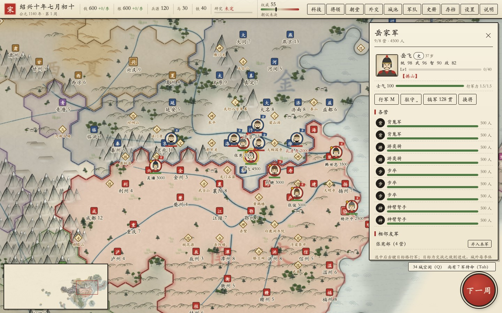

# 还我河山 · 大宋征服天下

绍兴十年（1140 年），岳家军兵锋直指汴京。你是大宋天子（开局为宋高宗赵构），岳飞、韩世忠诸将皆为你麾下之臣。治城理财、选将练兵、经营外交，在回合制的欧亚舆图上收复故土，并争取夺取诸国都城。

[在线试玩](https://lynch715.github.io/huanwoheshan/)

## 本地游玩

下载并解压仓库后，在浏览器中打开 `index.html` 即可。存档保存在当前浏览器，可在「存档」中导出或导入 JSON。

## 操作

- **桌面**：点击选取城池或军队，拖动舆图，滚轮缩放。选中军队后右键目标格行军，也可点击目标两次确认。按 Enter 结束回合，按 C 继续行军。
- **手机**：拖动舆图，双指或点按缩放按钮调整视野。选中军队后点目标格预览路线，再点一次下令。右上角政务菜单可打开科技、朝堂、存档与设置。
- **营救俘将**：在「文武百官 → 陷敌诸将」可查看被俘将领，已探明关押城方可寻城。可遣使赎回、以敌将换俘，或攻下关押城救人；仅击溃野战军不会放人。和议一成，双方所扣对方将领尽数归还，欲招降敌将须在议和前处置。

## 更新日志

### 0.18.0

- **补员与合营**　军驻本国城中，可按缺额急募，城守亦可补员。同一军团或同一城守军中，同兵种残营可合，余兵悉留，空营除籍，以省军饷。
- **军中休整**　军团与城守休整补员，皆取诸丁口。丁口不敷，则按余量补之。周、旬、月、季四制，皆以每季同率折算。

### 0.17.0

- **宝物府库与赐予**　可从将领处收归宝物，或由府库转赐。每件每季限转手一次，收归与赐还旧主会额外影响忠诚。兵书和经籍可各佩一部，俘获敌将可缴其宝物。
- **遣散兵马**　可遣散野战军和城中守军，节省军饷。在本国境内遣散时，可按现有兵力收还半数征募丁口。
- **存档修复**　联姻时日与求亲记录在存读档后采用一致的精度。

### 0.15.0

- **合纵连横**　鸿胪寺新设「天下侧目」。宋势日盛，诸国或诘问、会盟，继而同日共讨。朝廷可离间敌盟，亦可纳岁币单独媾和。
- **封爵与册封藩属**　功臣可循功晋爵。远将拥兵自重，可遣诏召还；朝臣亦可议行杯酒释兵权。弱邦受册为藩，输贡从征，久而交好者或请纳土。
- **宗室联姻**　宗室女可下嫁姻邦，暂息边患。强国求亲，朝廷可备嫁妆许之、以岁币代之，或辞其请。姻邦势弱，外孙继统时或请奉藩。

## 反馈

制作人 大老师。试玩中，欢迎通过微信 `lynchrrr` 反馈问题与建议。
